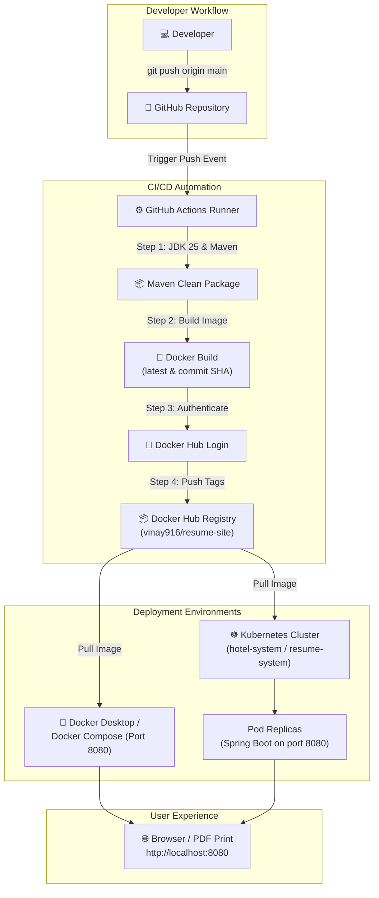

# 📄 Vinay Yadav - Personal Resume & Portfolio Web Application

[](https://spring.io/projects/spring-boot)
[](https://www.oracle.com/java/)
[](https://www.docker.com/)
[](https://hub.docker.com/r/vinay916/resume-site)
[](https://kubernetes.io/)
[](https://github.com/vinay0716yadav-ops/resume/actions)
[](https://www.linkedin.com/in/vinay-yadav-3067583a2)
[](LICENSE)

A production-ready, containerized **Personal Resume & Portfolio Web Application** built with **Spring Boot 3**, **Docker**, and **Kubernetes**. Powered by an automated **GitHub Actions CI/CD pipeline** that packages the application with Maven, builds Docker images with `latest` and Git commit SHA version tags, and pushes them to Docker Hub (`vinay916/resume-site`) on every push to the `main` branch.

---

## 📑 Table of Contents

- [About Vinay](#-about-vinay)
- [Key Features](#-key-features)
- [System Architecture](#-system-architecture)
- [Tech Stack](#-tech-stack)
- [Project Directory Structure](#-project-directory-structure)
- [Getting Started Locally](#-getting-started-locally)
- [Containerization with Docker](#-containerization-with-docker)
  - [Build and Run Standalone Container](#1-build-and-run-standalone-container)
  - [Run with Docker Compose](#2-run-with-docker-compose)
- [Deploying on Kubernetes (K8s)](#-deploying-on-kubernetes-k8s)
  - [1. Quick Deploy with Kustomize](#1-quick-deploy-with-kustomize)
  - [2. Step-by-Step Deployment](#2-step-by-step-deployment)
  - [3. Access the Application](#3-access-the-application)
  - [4. Useful Kubernetes Commands](#4-useful-kubernetes-commands)
- [GitHub Actions CI/CD Pipeline](#-github-actions-cicd-pipeline)
  - [Pipeline Workflow](#pipeline-workflow)
  - [Setting Up Docker Hub Credentials in GitHub Secrets](#setting-up-docker-hub-credentials-in-github-secrets)
- [Print & PDF Export](#-print--pdf-export)
- [Connect & Contact](#-connect--contact)
- [License](#-license)

---

## 👨‍💻 About Vinay

**Vinay Kumar Ramchandra Yadav**  
*Undergraduate in Electronics & Computer Science Engineering*  
📍 Vivekanand Education Society's Institute of Technology (VESIT), Mumbai | **CGPA: 9.11**  
Focus areas: **Cybersecurity, SOC Analysis, Digital Design (FPGA/SERDES), Embedded Systems & DevOps**.

- 🛡️ **Ex-Security Analyst Intern** at *Quantilix Insights* (SOC operations, log analysis, threat triage).
- ⚡ **Digital Design Intern** at *VESIT × Panache Digilife* (Chips to Startup program, FPGA, SERDES, Sigma-Delta ADC).
- 🏆 **Sr. Deputy Secretary**, VESIT Sports Council & Multi-tournament Sports Winner.

---

## 🌟 Key Features

### 📄 1. High-Performance Web Resume
- Elegant, responsive resume interface styled with modern typography (**Playfair Display** & **Inter**).
- Itemized sections: **Education**, **Professional Experience**, **Projects**, **Technical Skills**, **Certifications**, and **Achievements**.
- Verified certificate links for internships and CISCO certifications.

### 🖨️ 2. Native Print & PDF Export
- Tailored CSS media queries (`@media print`) that automatically strip browser margins and shadows for a pristine single-page PDF document.

### 🐳 3. Portable Docker Containerization
- Ultra-lightweight runtime container based on `eclipse-temurin:25-jre`.
- Configured with container-aware JVM flags (`-XX:+UseContainerSupport`, `-XX:MaxRAMPercentage=75.0`).
- Consistent execution environment across Linux, macOS, and cloud hosts.

### ☸️ 4. Enterprise Kubernetes Deployment
- Production-ready Kubernetes manifests: **Namespace**, **ConfigMap**, **Deployment (2 Replicas)**, **LoadBalancer Service**, **Ingress**, and **Kustomize**.
- Zero-downtime rolling updates with liveness and readiness health probes.

### 🔄 5. Automated CI/CD Pipeline (GitHub Actions)
- Continuous Integration & Deployment automated on every push to `main`.
- Compiles source code with Maven, verifies build integrity, builds container images, and publishes dual tags (`latest` and `sha-<commit>`) to Docker Hub.

---

## 🏗️ System Architecture



---

## 💻 Tech Stack

| Domain | Technologies |
| :--- | :--- |
| **Backend & Framework** | Java 25, Spring Boot 3.5.x, Embedded Tomcat |
| **Frontend UI** | Semantic HTML5, Custom CSS3, Google Fonts (*Playfair Display*, *Inter*), Print CSS |
| **Containerization** | Docker, Docker Compose, Docker Hub (`vinay916/resume-site`) |
| **Orchestration** | Kubernetes (Deployments, Services, ConfigMaps, Ingress, Kustomize) |
| **CI/CD Automation** | GitHub Actions (`actions/checkout@v4`, `actions/setup-java@v4`, `docker/login-action@v3`) |
| **Build & Tooling** | Apache Maven 3.9.x, Git |

---

## 📂 Project Directory Structure

```text
resume/
├── .github/
│   └── workflows/
│       └── docker.yml                 # GitHub Actions CI/CD pipeline
├── k8s/                               # Kubernetes deployment manifests
│   ├── namespace.yaml                 # Dedicated 'resume-system' namespace
│   ├── configmap.yaml                 # Application configuration & env variables
│   ├── app-deployment.yaml            # High-Availability Deployment (2 Replicas)
│   ├── app-service.yaml               # LoadBalancer Service (Port 80 -> 8080)
│   ├── ingress.yaml                   # Ingress routing rule (resume.local)
│   ├── kustomization.yaml             # 1-command deployment aggregator
│   └── deploy.sh                      # Executable rollout automation script
├── src/
│   ├── main/
│   │   ├── java/com/vinay/resume/
│   │   │   └── ResumeApplication.java # Spring Boot main entry point
│   │   └── resources/
│   │       ├── application.properties # Server configuration (Port 8080)
│   │       └── static/
│   │           └── index.html         # Responsive resume & portfolio UI
│   └── test/
│       └── java/com/vinay/resume/
│           └── ResumeApplicationTests.java
├── Dockerfile                         # Container build definition
├── .dockerignore                      # Build context exclusion list
├── docker-compose.yml                 # Local container orchestration
├── pom.xml                            # Maven project descriptor
└── README.md                          # Comprehensive documentation
```

---

## 🚀 Getting Started Locally

### Prerequisites
- **JDK 25** (or JDK 21+)
- **Apache Maven 3.8+**

### 1. Clone & Run with Maven
```bash
# Clone the repository
git clone https://github.com/vinay0716yadav-ops/resume.git
cd resume

# Build and start the Spring Boot application
mvn spring-boot:run
```

Once the application starts, open your browser:
👉 **[http://localhost:8080](http://localhost:8080)**

---

## 🐳 Containerization with Docker

### 1. Build and Run Standalone Container

#### Pre-build the JAR:
```bash
mvn clean package
```

#### Build Docker Image:
```bash
docker build -t vinay916/resume-site:latest .
```

#### Run Container:
```bash
docker run -d -p 8080:8080 --name resume-website vinay916/resume-site:latest
```

Verify the container is running:
```bash
docker ps
curl http://localhost:8080
```

---

### 2. Run with Docker Compose

Run the application using Docker Compose:
```bash
docker-compose up -d --build
```

To stop the container:
```bash
docker-compose down
```

---

## ☸️ Deploying on Kubernetes (K8s)

The repository provides production-ready Kubernetes manifests located in [`k8s/`](k8s/):

### 1. Quick Deploy with Kustomize

Deploy all resources in a single command:
```bash
# Apply all manifests using Kustomize
kubectl apply -k k8s/

# Or run the included automation helper script
chmod +x k8s/deploy.sh
./k8s/deploy.sh
```

---

### 2. Step-by-Step Deployment

```bash
# 1. Create the dedicated Namespace
kubectl apply -f k8s/namespace.yaml

# 2. Apply ConfigMap
kubectl apply -f k8s/configmap.yaml

# 3. Deploy Application (2 Replicas with probes)
kubectl apply -f k8s/app-deployment.yaml

# 4. Deploy Service (LoadBalancer)
kubectl apply -f k8s/app-service.yaml

# 5. (Optional) Apply Ingress rule
kubectl apply -f k8s/ingress.yaml
```

---

### 3. Access the Application

#### Port Forwarding (Local / Minikube / Docker Desktop):
```bash
kubectl port-forward svc/resume-service 8080:80 -n resume-system
```
Open **[http://localhost:8080](http://localhost:8080)** in your browser.

#### LoadBalancer (Cloud EKS / GKE / AKS):
```bash
kubectl get svc resume-service -n resume-system
```
Access directly through the assigned `EXTERNAL-IP`.

---

### 4. Useful Kubernetes Commands

```bash
# Check Pods status
kubectl get pods -n resume-system

# View live application logs
kubectl logs -f deployment/resume-deployment -n resume-system

# Scale application replicas
kubectl scale deployment/resume-deployment --replicas=4 -n resume-system

# Teardown all resources
kubectl delete -k k8s/
```

---

## 🔄 GitHub Actions CI/CD Pipeline

The repository includes an automated pipeline defined in [`.github/workflows/docker.yml`](.github/workflows/docker.yml).

### Pipeline Workflow

```text
┌─────────────────────────────────┐
│     Git Push to main Branch     │
└────────────────┬────────────────┘
                 │
                 ▼
┌─────────────────────────────────┐
│     📥 Check Out Repository     │
└────────────────┬────────────────┘
                 │
                 ▼
┌─────────────────────────────────┐
│   ☕ Set Up JDK 25 & Maven      │
└────────────────┬────────────────┘
                 │
                 ▼
┌─────────────────────────────────┐
│   📦 Maven Build & Package      │──► Compiles code & runs test suite
└────────────────┬────────────────┘
                 │
                 ▼
┌─────────────────────────────────┐
│   🔑 Log In to Docker Hub       │──► Uses DOCKER_USERNAME & DOCKER_PASSWORD
└────────────────┬────────────────┘
                 │
                 ▼
┌─────────────────────────────────┐
│   🐳 Build Docker Image         │──► Tags: 'latest' & 'sha-<commit>'
└────────────────┬────────────────┘
                 │
                 ▼
┌─────────────────────────────────┐
│   🚀 Push Images to Docker Hub  │──► Published to vinay916/resume-site
└────────────────┬────────────────┘
                 │
                 ▼
┌─────────────────────────────────┐
│   📋 Step Summary Generated     │──► Displays deployment summary in GitHub UI
└─────────────────────────────────┘
```

### Setting Up Docker Hub Credentials in GitHub Secrets

To allow the automated pipeline to publish images to your Docker Hub repository:

1. **Create Docker Hub Access Token**:
   - Log in to [Docker Hub](https://hub.docker.com/).
   - Go to **Account Settings** $\rightarrow$ **Security** $\rightarrow$ **New Access Token**.
   - Set description to `github-actions-resume` and permissions to **Read, Write, Delete**.
   - Copy the generated token.

2. **Add Secrets to GitHub**:
   - Navigate to your repository $\rightarrow$ **Settings** $\rightarrow$ **Secrets and variables** $\rightarrow$ **Actions**.
   - Add the following repository secrets:
     - `DOCKER_USERNAME`: Your Docker Hub username (`vinay916`)
     - `DOCKER_PASSWORD`: Your Docker Hub Access Token

3. **Trigger Build**:
   - Push any commit to `main`, and GitHub Actions will automatically test, build, tag, and publish your image!

---

## 🖨️ Print & PDF Export

The web resume includes print-optimized stylesheet rules (`@media print`):
1. Open the website at [http://localhost:8080](http://localhost:8080).
2. Press **`Cmd + P`** (Mac) or **`Ctrl + P`** (Windows/Linux).
3. Select **"Save as PDF"** as the destination.
4. Set **Margins** to *Default* or *None* for a pixel-perfect, clean single-page document.

---

## 📬 Connect & Contact

- **Name**: Vinay Kumar Ramchandra Yadav
- **Email**: [vinay0716yadav@gmail.com](mailto:vinay0716yadav@gmail.com) | [2023.vinay.yadav@ves.ac.in](mailto:2023.vinay.yadav@ves.ac.in)
- **Phone**: +91-8169166211
- **LinkedIn**: [linkedin.com/in/vinay-yadav-3067583a2](https://www.linkedin.com/in/vinay-yadav-3067583a2)
- **GitHub**: [github.com/vinay0716yadav-ops](https://github.com/vinay0716yadav-ops)
- **Docker Hub**: [hub.docker.com/r/vinay916/resume-site](https://hub.docker.com/r/vinay916/resume-site)

---

## 📄 License

This project is licensed under the [MIT License](LICENSE).
